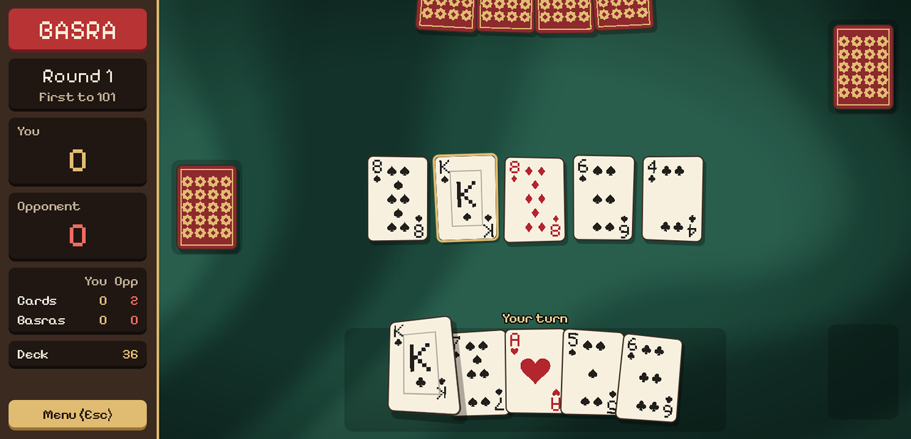

# Basra

A Lebanese take on Basra, the Middle Eastern fishing card game, made in Godot.
Play against the computer, capture cards from the table, and race to 101 points.

**[Play it in your browser at jongomez.dev/basra](https://jongomez.dev/basra/)**



## How to play

Four cards go face up on the table and each player gets six. On your turn, play
one card from your hand:

- **Match:** it takes every table card of the same rank.
- **Add up:** a number card also takes groups of table cards that add up to its
  value. Aces count as 1, so an 8 can take a 2 and a 6.
- **Queens and kings** only take matching queens and kings.
- **Jacks** sweep the whole table.
- If it takes nothing, the card stays on the table.

When both hands are empty, everyone gets six more until the deck runs out. A
jack never starts on the table: it goes back into the deck and is replaced.

**Basra:** clear the whole table in one play, by matching or adding up, for a
10-point bonus. Sweeping with a jack never counts.

At the end of a round, whoever captured last takes the cards left on the table.
The first to 101 points at the end of a round wins.

### Scoring

| Card or bonus | Points |
|---|---|
| 10 of diamonds | 3 |
| 2 of clubs | 2 |
| Each ace | 1 |
| Each jack | 1 |
| Most cards captured (no one on a tie) | 3 |
| Each Basra | 10 |

### Controls

- **Hover** over a card in your hand to see what it would capture.
- **Click** a card to play it.
- **Esc** or the **Menu** button opens the pause menu, with the rules, a scoring
  cheat sheet, a sound toggle and a new game.
- On a phone, play in landscape.

## Running it locally

1. Install [Godot 4.7](https://godotengine.org/download).
2. Open this folder as a project in Godot.
3. Press **F5** to play.

The rules and AI tests in `tests/` run through the bundled
[Godot AI](addons/godot_ai/) editor plugin's test runner.

## Publishing the web build

The game is published to GitHub Pages from the `gh-pages` branch. With Godot's
Web export templates installed, run:

```bash
tools/deploy_web.sh
```

It exports the single-threaded Web build and replaces the `gh-pages` branch with
it. The site updates a minute or two later.

## Project layout

| Path | What's there |
|---|---|
| `scripts/core/` | Rules, scoring, match flow and the AI. No UI code. |
| `scripts/ui/` | The table, cards, effects, pause menu and sound. |
| `scenes/main.tscn` | The game screen. |
| `shaders/` | The marbled felt and the card tilt. |
| `tests/` | Rules and match tests. |
| `tools/deploy_web.sh` | Exports and publishes the web build. |

## License

Basra is licensed under the [GNU General Public License v3.0](LICENSE). The
bundled Godot AI plugin (MIT) and the Pixelify Sans font (SIL Open Font
License) keep their own licenses; see [NOTICE.md](NOTICE.md).
